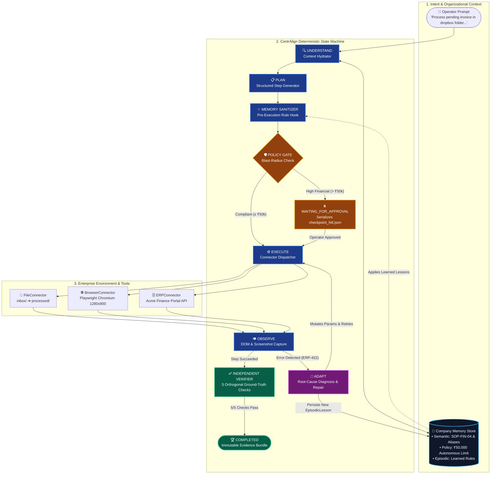
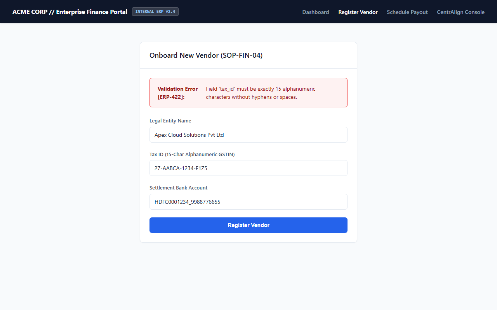
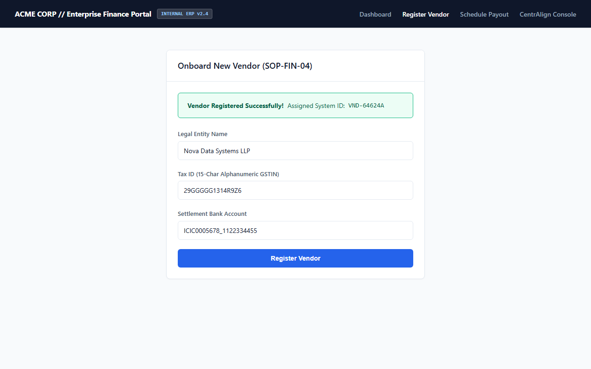
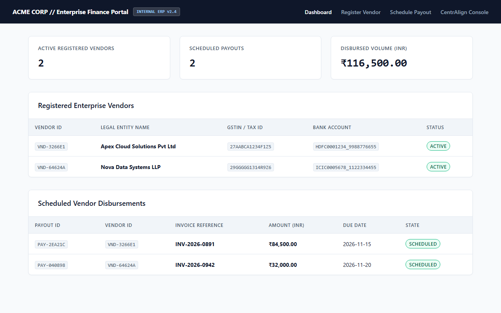

<div align="center">

<!-- ANIMATED WAVING HEADER BANNER -->


<!-- LIVE ANIMATED TYPING TERMINAL SUBTITLE -->
<a href="https://github.com/">
  
</a>

<br/>

<!-- STATUS & TECH STACK BADGES -->
<p>
  
  
  
  
  
</p>

<p>
  <a href="#-quickstart-run-in-3-commands"><b>⚡ Quickstart</b></a> •
  <a href="#-system-architecture--state-machine"><b>🏛️ Architecture</b></a> •
  <a href="#-the-golden-path-two-run-autonomy-proof"><b>🔄 Two-Run Proof</b></a> •
  <a href="#-visual-execution-evidence-playwright"><b>📸 Visual Evidence</b></a> •
  <a href="#-enterprise-production-roadmap"><b>🗺️ Production Roadmap</b></a>
</p>

</div>

---

## 🎯 Executive Thesis: Why Most Agent Prototypes Fail

Most AI agent prototypes fail in enterprise production because they treat the **Large Language Model (LLM)** as the runtime itself—relying on unconstrained prompt loops to remember company procedures, enforce financial limits, recover from broken UI/API calls, and self-report completion.

**CentrAlign inverts this paradigm:**

> **The Runtime is a deterministic, persistent state machine; the LLM is a bounded reasoning component invoked strictly for ambiguity resolution, planning, and failure diagnosis.**

| Architectural Dimension | Naive ReAct / Prompt Loop | 🛡️ CentrAlign Operator Runtime |
| :--- | :--- | :--- |
| **Organizational Context** | Stuffed into fragile system prompts | **3-Tier Company Memory** (Semantic SOPs, Policy Limits, Episodic Lessons) |
| **Data Flow Between Steps** | LLM re-generates JSON payloads every turn | **Late-Bound Pointers** (`$working_memory.*`) resolved deterministically |
| **Permissions & Blast Radius** | Prompt warning (*"Don't spend over ₹50k"*) | **Deterministic Policy Gate** intercepting high-risk calls + disk checkpointing |
| **Error Recovery** | Blind retries or hallucinated parameters | **Observe → Adapt Loop** that diagnoses DOM/API errors & persists learned rules |
| **Definition of Done** | LLM outputs `"I have completed the task!"` | **5-Point Independent Verifier** auditing DB state, filesystem, and live DOM |

---

## 🏛️ System Architecture & State Machine

GitHub natively renders the vector architecture and state machine topology below:



---

## 🔄 The Golden Path: Two-Run Autonomy Proof

Instead of mocking autonomy across dozens of shallow tools, CentrAlign proves genuine end-to-end autonomy on an **Enterprise Vendor Onboarding & Payout Workflow** across a local filesystem and the **Acme Finance Portal** (`http://127.0.0.1:8001`).

```mermaid
sequenceDiagram
    autonumber
    participant Op as 👤 Operator
    participant RT as ⚙️ CentrAlign Runtime
    participant Mem as 🧠 Company Memory
    participant PW as 🌐 Playwright / Portal UI
    participant Ver as ✅ Outcome Verifier

    rect rgb(30, 41, 59)
    Note over Op,Ver: RUN 1: inv_01_apex.json (₹84,500 • Raw Tax ID: "27-AABCA-1234-F1Z5")
    Op->>RT: "Process pending invoice in dropbox folder..."
    RT->>Mem: Hydrate aliases ("dropbox" ➔ ./workspace/inbox) & SOP-FIN-04
    RT->>PW: POST /vendors/new (Attempt 1: "27-AABCA-1234-F1Z5")
    PW-->>RT: ❌ ERP-422 Error Banner (Hyphens Rejected) + Failure Screenshot
    RT->>Mem: 🔧 ADAPT: Strip hyphens ➔ Persist Lesson LSN-001
    RT->>PW: POST /vendors/new (Attempt 2: "27AABCA1234F1Z5")
    PW-->>RT: ✅ Registered (VND-XXXXXX) + Success Screenshot
    RT->>Op: ⏸️ POLICY GATE: ₹84,500 > ₹50,000 Limit (Saves checkpoint_hitl.json)
    Op-->>RT: Approve Execution
    RT->>PW: POST /payouts/new (₹84,500) ➔ PAY-XXXXXX Scheduled
    RT->>Ver: Execute 5 Independent Ground-Truth Checks
    Ver-->>Op: 🏆 Run 1 COMPLETED (Evidence Bundle Saved)
    end

    rect rgb(6, 78, 59)
    Note over Op,Ver: RUN 2: inv_02_nova.json (₹32,000 • Raw Tax ID: "29-GGGGG-1314-R9Z6")
    Op->>RT: "Process next pending invoice..."
    RT->>Mem: Load Lesson LSN-001 (Pre-sanitize Tax ID BEFORE Attempt 1)
    RT->>PW: POST /vendors/new (Attempt 1: "29GGGGG1314R9Z6")
    PW-->>RT: ⚡ Registered on Attempt 1 (ZERO Browser Errors!)
    RT->>PW: Policy Check (₹32,000 ≤ ₹50,000) ➔ Auto-Schedule Payout
    RT->>Ver: Execute 5 Independent Ground-Truth Checks
    Ver-->>Op: 🏆 Run 2 COMPLETED (100% Autonomous)
    end
```



### 📊 Run 1 vs. Run 2 Benchmark Comparison

| Benchmark Dimension | Run 1 (`inv_01_apex.json`) | Run 2 (`inv_02_nova.json`) |
| :--- | :---: | :---: |
| **Vendor Name** | Apex Cloud Solutions Pvt Ltd | Nova Data Systems LLP |
| **Invoice Amount** | `₹84,500.00` | `₹32,000.00` |
| **Raw Input Tax ID (GSTIN)** | `27-AABCA-1234-F1Z5` *(Invalid)* | `29-GGGGG-1314-R9Z6` *(Invalid)* |
| **Browser Onboarding Attempts** | **2 Attempts** *(Failed Attempt 1 → Adapted)* | **1 Attempt** *(Pre-Sanitized via Memory)* |
| **Episodic Memory Action** | **Learned & Saved Rule** (`strip_hyphens...`) | **Applied Learned Rule** *(0 UI Errors)* |
| **HITL Policy Gate (`> ₹50,000`)** | **Triggered & Checkpointed** | **Bypassed Automatically** (`≤ ₹50,000`) |
| **Independent Verification** | **5 / 5 Checks PASSED** | **5 / 5 Checks PASSED** |

---

## 📸 Visual Execution Evidence (Playwright)

Every browser action captures a `1280x800` full-page PNG receipt inside `./workspace/evidence/`.

### Run 1: Self-Healing Validation Recovery (`inv_01_apex.json`)
<table>
  <tr>
    <th width="50%">🔴 Attempt 1: <code>ERP-422</code> Hyphenated Tax ID Rejected</th>
    <th width="50%">🟢 Attempt 2: Self-Healed & Vendor Onboarded</th>
  </tr>
  <tr>
    <td></td>
    <td></td>
  </tr>
  <tr>
    <td align="center"><em>Playwright observes <code>#error-banner</code> when submitting <code>27-AABCA-1234-F1Z5</code></em></td>
    <td align="center"><em>Runtime strips hyphens, saves episodic lesson, and succeeds on Attempt 2</em></td>
  </tr>
</table>

### Run 2: Episodic Memory Pre-Sanitization & Final Verification (`inv_02_nova.json`)
<table>
  <tr>
    <th width="50%">⚡ Attempt 1: Zero-Error Onboarding via Learned Memory</th>
    <th width="50%">✅ Independent Verifier: Live Dashboard DOM Receipt</th>
  </tr>
  <tr>
    <td></td>
    <td></td>
  </tr>
  <tr>
    <td align="center"><em><code>29-GGGGG-1314-R9Z6</code> sanitized to <code>29GGGGG1314R9Z6</code> before Attempt 1</em></td>
    <td align="center"><em>Independent verifier confirms both vendors & payouts on live ERP dashboard</em></td>
  </tr>
</table>

<details>
<summary><b>🔍 Click to Inspect Persisted Episodic Lesson in <code>workspace/company_memory.json</code></b></summary>

```json
{
  "lesson_id": "LSN-001",
  "tool_name": "browser.register_vendor_ui",
  "error_signature": "ERP-422",
  "parameter_name": "tax_id",
  "transformation_rule": "strip_hyphens_and_spaces_uppercase",
  "explanation": "Acme Finance Portal requires 15-character alphanumeric GSTIN without hyphens or spaces."
}
```
</details>

<details>
<summary><b>🔍 Click to Inspect the 5 Independent Verification Predicates (<code>core/verifier.py</code>)</b></summary>

| # | Check Name | Verification Source | Ground-Truth Assertion |
| :-: | :--- | :--- | :--- |
| **1** | `vendor_persisted` | `GET /api/verify/state` | `vendor_id` exists in ERP database & `tax_id` is 15 alphanumeric chars |
| **2** | `payout_scheduled` | `GET /api/verify/state` | `payout_id` exists in ERP database with `state == "SCHEDULED"` |
| **3** | `amount_integrity` | Cross-System Reconciliation | Scheduled ERP payout amount matches raw JSON invoice `amount_inr` |
| **4** | `file_lifecycle` | Local Filesystem | Invoice removed from `workspace/inbox/` and archived in `workspace/processed/` |
| **5** | `visual_dom_receipt` | Playwright Headless DOM | `payout_id` rendered inside `#payouts-table` on `/` + screenshot captured |

</details>

---

## ⚡ Quickstart (Run in 3 Commands)

### 1. Install Dependencies & Chromium
```bash
pip install -r requirements.txt
playwright install chromium
```

### 2. Run the Turnkey Two-Run Demo
```bash
python run_demo.py --auto-approve
```
> 💡 **Interactive HITL Mode:** Run `python run_demo.py --interactive` to manually approve or reject the ₹84,500 payout when the Policy Gate pauses execution.

### 3. Run the End-to-End Automated Test Suite
```bash
pytest -v
```

---

## 🖥️ Built-In Web Observability Console (`/console`)

To inspect the **Acme Finance Portal** and the **CentrAlign Operator Console** in your browser:

```bash
uvicorn portal_app.app:app --host 127.0.0.1 --port 8001
```

- **Operator Console (`http://127.0.0.1:8001/console`):** Displays the learned **Episodic Memory Bank**, step-by-step execution traces (`[MEMORY APPLIED]`, `[SELF-HEALED]`, `[HITL APPROVED]`), verification badges, and Playwright screenshot gallery.
- **Enterprise ERP Dashboard (`http://127.0.0.1:8001/`):** Displays live registered vendors and scheduled payouts.

---

## 📂 Repository Structure

```text
centralign-operator/
├── portal_app/                     # Target Enterprise Web Application (FastAPI)
│   ├── app.py                      # ERP Routes (/vendors/new, /payouts/new, /console)
│   └── templates/index.html        # Enterprise UI + Operator Observability Console
├── core/                           # CentrAlign Deterministic Runtime Engine
│   ├── models.py                   # Pydantic v2 State, Plan, Memory & Verification schemas
│   ├── memory.py                   # Semantic, Policy & Episodic Memory Store
│   ├── llm.py                      # Dual-mode LLM Structured Output + Fallback Engine
│   ├── policy.py                   # Blast-Radius Policy Evaluator & HITL Checkpointer
│   ├── verifier.py                 # 5-Point Independent Outcome Verifier
│   └── runtime.py                  # 8-Stage Execution State Machine
├── connectors/                     # Zero-Trust Tool & Computer-Use Abstractions
│   ├── base.py                     # BaseConnector & Standardized ToolResult
│   ├── file_connector.py           # Workspace Inbox Ingestion & Archival
│   ├── browser_connector.py        # Playwright Chromium Operator + Screenshot Capture
│   └── erp_api_connector.py        # Read-Only Ground-Truth ERP API Connector
├── workspace/                      # Live Workspace & Generated Audit Artifacts
│   ├── company_memory.json         # Organizational SOPs, Policies & Learned Lessons
│   ├── inbox/                      # Pending Invoices (inv_01_apex.json, inv_02_nova.json)
│   ├── processed/                  # Archived Invoices
│   └── evidence/                   # Per-Run JSON Reports, Checkpoints & PNG Screenshots
├── run_demo.py                     # Rich CLI Orchestrator (Run 1 + Run 2 Benchmark)
└── tests/test_runtime.py           # Automated End-to-End Pytest Suite
```

---

## 🗺️ Enterprise Production Roadmap

Every module boundary in this prototype is designed to scale directly into a multi-tenant production deployment:

1. **Durable Execution & Distributed Queues:**
   - *PoC:* In-process state machine with JSON disk checkpoints (`checkpoint_hitl.json`).
   - *Production:* **Temporal.io** workflows or PostgreSQL-backed queues (`pgmq`). When a run enters `WAITING_FOR_APPROVAL`, the worker releases compute completely and resumes via webhook when approved in Slack or Teams.
2. **Isolated Computer-Use Sandboxes:**
   - *PoC:* Local headless Chromium via Playwright.
   - *Production:* Ephemeral per-tenant **Firecracker microVMs** / browser containers supporting both DOM automation and OS-level desktop automation with live WebRTC/VNC streaming.
3. **Hybrid Organizational Memory:**
   - *PoC:* Structured JSON document (`company_memory.json`).
   - *Production:* **PostgreSQL + `pgvector`** combining strict relational policy tables with semantic retrieval over enterprise wikis (Notion/Confluence) and tenant-scoped episodic execution traces.
4. **Zero-Trust Credential Proxy:**
   - *PoC:* Local environment variables.
   - *Production:* Connectors never hold raw credentials; session cookies and bearer tokens are injected at the network boundary via short-lived **HashiCorp Vault** leases.

---

<div align="center">
  
</div>